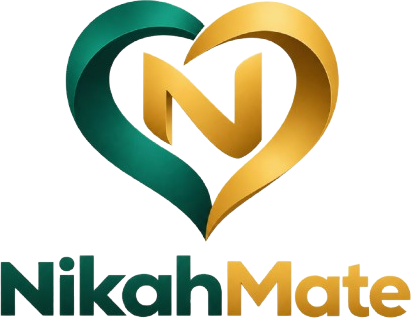

# NikahMate brand

**The official identity.** What ships on Google Play, the App Store, the future
website, the admin panel and every marketing surface.

---

## The mark



A heart formed from two interlocking ribbons — one emerald, one gold — with the
**N** monogram held inside the fold. Two strands, distinct and complete on their
own, becoming one form. Beneath it the wordmark: **Nikah** in emerald, **Mate**
in gold.

The artwork is supplied, not generated. The original lives at
[`brand/source/nikahmate-logo-source.png`](brand/source/) and every asset in the
app is derived from it by one script, so the identity has a single source of
truth rather than a folder of hand-edited exports.

---

## Official versions

| Version                 | File                                                     | Use                                            |
| ----------------------- | -------------------------------------------------------- | ---------------------------------------------- |
| **Symbol**              | [`brand/symbol.png`](brand/symbol.png)                   | Transparent. The mark alone                    |
| **Symbol on light**     | [`brand/symbol-on-light.png`](brand/symbol-on-light.png) | Warm-white ground                              |
| **Symbol on dark**      | [`brand/symbol-on-dark.png`](brand/symbol-on-dark.png)   | Deep emerald ground                            |
| **Wordmark**            | [`brand/wordmark.png`](brand/wordmark.png)               | Transparent, two-tone                          |
| **Full lockup**         | [`brand/lockup.png`](brand/lockup.png)                   | Transparent. Store listings, marketing         |
| **App icon**            | `../apps/mobile/assets/icon.png`                         | 1024, full bleed, symbol on emerald            |
| **Adaptive foreground** | `../apps/mobile/assets/adaptive-icon.png`                | Transparent, inside the Android mask safe zone |
| **Splash**              | `../apps/mobile/assets/splash-icon.png`                  | 512, transparent                               |
| **Favicon**             | `../apps/mobile/assets/favicon.png`                      | 64, symbol on emerald                          |

### Three production decisions worth knowing

**The icon carries the symbol alone.** The supplied wordmark is emerald and
gold; on the dark icon ground the emerald word would disappear, and a wordmark
is not legible at launcher size in any case. The full lockup stays for store
listings and marketing, where it is seen large and on light.

**The icon ground runs near-black green, deeper than the UI gradient.** One half
of the heart is emerald. On a mid-emerald ground that half sinks into the
background and the mark reads as a lone gold swoosh. `#022018` → `#064E3A` holds
both halves.

**The in-app wordmark is live text, not an image** — crisp at any size, takes
the theme, and the two-tone treatment lives in one component instead of an
export.

### Resolution

The supplied source is **500 × 500**, and the symbol occupies **274 × 242** of
it. That is enough for the app and not enough for everything:

| Asset                    | Scale from source | Verdict                               |
| ------------------------ | ----------------- | ------------------------------------- |
| `logo-symbol.png` (512)  | 1.9×              | Fine — covers 88dp at 3× density      |
| `adaptive-icon.png`      | 2.0×              | Acceptable — the launcher draws small |
| `icon.png` (1024, store) | 2.3×              | **Soft at full size**                 |

The build script prints the factor for every asset and flags anything past 1.5×.
Resampling cannot invent detail. A genuinely sharp 1024 store icon needs the
symbol to be **~600px** in the source; print or a true 4K render needs **vector
(SVG/PDF) or ~2000px**. Re-export the artwork larger, drop it in `brand/source/`
and rerun the script — no other file changes.

### Regenerating

```bash
python apps/mobile/scripts/build-brand-assets.py
```

Pillow is required. It is a developer tool, not an app dependency.

### In the app

```tsx
<Logo size={88} variant="stacked" tone="dark" />  // auth hero
<Logo size={44} />                                 // default: symbol, light
<Logo variant="horizontal" />                      // symbol + wordmark, inline
```

`variant`: `symbol` · `horizontal` · `stacked` — `tone`: `light` · `dark` · `mono`.

---

## Colour

Emerald is the brand. Gold is an accent for moments that deserve weight — the
monogram, a premium state, an earned badge. **Gold is never a surface and never
body text.**

| Role                    | Token          | Hex       |
| ----------------------- | -------------- | --------- |
| Near-black emerald      | `emerald[900]` | `#03291F` |
| Deep emerald            | `emerald[800]` | `#064E3B` |
| **Emerald — primary**   | `emerald[600]` | `#047857` |
| **Gold — accent**       | `gold[500]`    | `#D4AF37` |
| Soft gold               | `gold[300]`    | `#E5C76B` |
| Charcoal — text         | `neutral[900]` | `#111827` |
| Warm white — background | `neutral[25]`  | `#FAFAF7` |

Full ramps: [`apps/mobile/src/theme/palette.ts`](../apps/mobile/src/theme/palette.ts).

**Components never use a hex value.** They ask the theme for a _role_ — `brand`,
`textMuted`, `surfaceSunken` — which is what makes a dark theme a new mapping
rather than a rewrite.

**The hero gradient runs deeper than the primary one on purpose** — the same
reason the icon ground does. Gold never gradients; flat gold is what keeps the
accent from looking cheap.

---

## Typography

The **system sans** — SF Pro on iOS, Roboto on Android. Modern, neutral,
international; no font file, no network fetch and no dependency.

The wordmark is weight 700 at `-0.5` tracking, with **Nikah** in the neutral and
**Mate** in gold.

| Style      | Size / line height | Use              |
| ---------- | ------------------ | ---------------- |
| `display`  | 30 / 40            | Screen titles    |
| `title`    | 22 / 30            | Section titles   |
| `heading`  | 17 / 24            | Card headings    |
| `body`     | 15 / 23            | Body copy        |
| `caption`  | 13 / 19            | Secondary detail |
| `overline` | 11 / 16, tracked   | Eyebrows         |
| `tabLabel` | 11 / 16            | Tab bar          |

**Leading is generous — roughly 1.4–1.5 — on purpose.** Tight leading clips
descenders inside height-constrained containers, which is a bug that renders
fine at one string length and badly at another. It has already happened once,
in the tab bar, and `MAX_TAB_LABEL_CHARS` guards the budget that exposed it.

---

## Where the identity appears

| Surface                                  | Mark               | Emerald                            | Gold             |
| ---------------------------------------- | ------------------ | ---------------------------------- | ---------------- |
| App icon / splash                        | Symbol             | Ground                             | In the mark      |
| Auth hero                                | Stacked, dark tone | Deep gradient ground               | "Mate", monogram |
| Sign in                                  | —                  | Method icons, back action          | —                |
| Tab bar                                  | —                  | Active tab                         | —                |
| Discover / Interests / Messages / Family | —                  | Headings, accents                  | —                |
| Me                                       | Symbol, light tone | Selected language, headings        | In the mark      |
| Buttons                                  | —                  | Primary gradient, secondary border | —                |
| Cards, empty states, loading             | —                  | Overlines, spinner                 | —                |

Emerald carries every action and active state. Gold is held back so that where
it appears, it means something.

---

## Before store submission

**Confirm you hold the rights to the source artwork.** The identity is built
entirely from the file you supplied and contains no third-party asset from
anywhere else — but only you can confirm its provenance, and both stores require
that you own or are licensed for what you publish.
